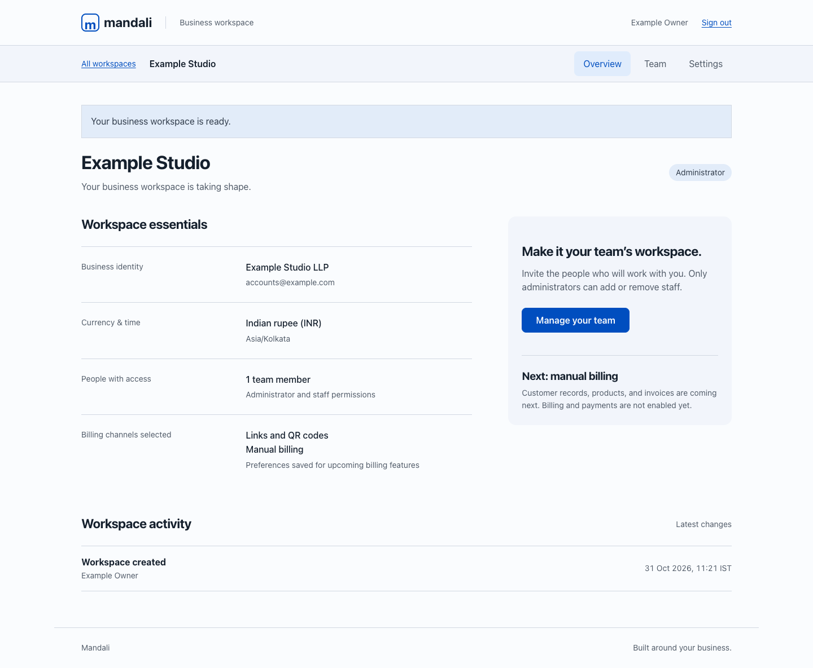

# Mandali

### Automated and manual billing, with or without a website.

Mandali is an India-first invoicing and subscription billing platform being developed for businesses with or without a website. It brings products, plans, quotations, one-time and recurring invoices, payment tracking, and reporting into one workspace, with INR as the initial currency.

Businesses with websites connect through authorized APIs. Businesses without websites share Mandali-hosted checkout links and QR codes with their customers. Both can also use manual billing and record externally collected payments. All channels use the same billing records.

The project is based on the **Subscription Management System** hackathon problem statement and its Brightloop Software scenario, where spreadsheets, manual invoices, and missed renewals make running a subscription business difficult.

> **Project status:** Parts 1 through 4, 6, and 7 are implemented. Part 1 covers email-based accounts, password recovery, business onboarding, isolated workspaces, administrator/staff access, staff invitations, and business settings. Part 2 adds manual billing: customers, products and variants, plans, taxes, discounts, quotation templates, quotations and subscriptions, INR invoices, and offline payment recording with partial payments. Part 3 adds mobile checkout, product/plan and sandbox invoice links, QR downloads, and verified Razorpay Test payments. Part 4 adds website API keys, ingestion endpoints, customer sync, and signed outgoing webhooks. Part 6 adds Cashfree Sandbox as a second gateway, gateway recommendations, a default gateway, opt-in automatic routing with explanations, and manual overrides. Part 7 adds credit notes, refunds, receipts, a customer portal with email sign-in links, business reports with CSV exports, a needs-attention list, and activity history. Recurring automation and live collection remain planned. See [foundation setup](docs/FOUNDATION.md) and [manual billing](docs/BILLING.md), [sandbox checkout setup](docs/CHECKOUT.md), [API integration](docs/INTEGRATIONS.md), [gateway routing](docs/GATEWAY_ROUTING.md), and [portal and reports](docs/PORTAL_AND_REPORTS.md).

See the [phased project plan](docs/PROJECT_PLAN.md) for the revised scope, acceptance criteria, and build order. We will implement and review one part at a time.

## Why Mandali?

Subscription businesses need a reliable way to answer everyday questions: Which subscriptions renew today? Has an invoice been paid? When does a discount expire? How much revenue is still outstanding?

Mandali aims to replace disconnected spreadsheets and manual billing work with a shared system for administrators, internal staff, and customers.

## Planned capabilities

| Area | Scope |
| --- | --- |
| Business workspaces | Isolated merchant accounts, business settings, INR billing, and admin/staff permissions. |
| Website integration | Authorized API data ingestion and fetching, field mapping, synchronization logs, and payment-status webhooks. |
| Hosted links and QR codes | Shareable checkout and invoice-payment pages for businesses that do not have a website. |
| Manual billing | Dashboard entry for customers, quotations, subscriptions, invoices, and externally collected payments. |
| Accounts and access | Customer registration, email-based password resets, and role-based access for administrators, internal staff, and customers. |
| Product catalog | Products with names, types, sales prices, cost prices, notes, and variants that can adjust pricing. |
| Subscription plans | Daily, weekly, monthly, and yearly billing; plan pricing; minimum quantities; availability dates; and configurable closure, pause, and renewal policies. |
| Quotations | Reusable templates with a plan, product lines, and a defined validity period. |
| Subscription lifecycle | Unique subscription numbers, customer and plan details, dates, payment terms, itemized lines, and visible lifecycle states. |
| Recurring invoicing | Invoices generated from due subscriptions with customer details, product lines, taxes, discounts, and totals. |
| Taxes and discounts | Admin-configured tax rules and fixed or percentage discounts with eligibility rules, validity dates, and usage limits. |
| Payment tracking | Payments recorded against invoices with a method, amount, date, and note; visibility into paid and outstanding invoices. |
| Customer portal | Customers can view and manage their own subscriptions and access their own invoices. |
| Reporting | Filterable summaries of active subscriptions, revenue, payments, outstanding balances, and overdue invoices. |
| Gateway selection | Explained recommendations, a merchant-selected default, and later opt-in routing across eligible connected gateways. |

Automated invoice generation and automated payment collection are separate options. Recurring collection requires customer authorization and gateway support. Gateway recommendations consider eligibility, payment method, currency, costs, availability, and measured performance; merchants retain control.

## Who uses it?

| Role | Intended access |
| --- | --- |
| Business administrator | Controls their business workspace, configures products, plans, taxes, and discounts, and is the only business role allowed to add internal staff. |
| Internal staff | Handles day-to-day customer, quotation, subscription, invoice, and payment work within assigned permissions. |
| Customer | Accesses only their own subscriptions and invoices through the customer portal. |

## Core workflows

### From quotation to subscription

1. Configure products, variants, and a billing plan.
2. Prepare an offer using a quotation template with the appropriate plan and product lines.
3. Assign the customer, subscription number, start and expiry dates, and payment terms.
4. Confirm the subscription and track its lifecycle:

```text
Draft -> Quotation -> Confirmed -> Active -> Closed
```

Each subscription line records its product, quantity, unit price, taxes, and amount. Early closure, pausing, renewal, and automatic closure depend on the plan's configured policies.

### From billing to payment

1. Identify subscriptions due for billing.
2. Generate invoices using the subscription's customer details and product lines.
3. Calculate taxes and apply eligible discounts automatically.
4. Confirm, send, or print invoices; support cancellation where needed.
5. Record payments against the correct invoice and track outstanding balances.

The main invoice lifecycle is:

```text
Draft -> Confirmed -> Paid
```

Billing must prevent both duplicate invoices and missed billing periods.

### Discount rules

Only administrators can create discount rules. Planned rules support:

- Fixed-amount or percentage discounts.
- Minimum purchase amounts or quantities.
- Start and end dates.
- Limits on the number of uses.
- Application to selected products or entire subscriptions.

Eligible discounts should appear automatically on the next invoice and stop applying when they expire or reach their usage limit.

## Key requirements

- **Unique accounts:** Each email address belongs to only one account.
- **Password rules:** Passwords must contain more than eight characters, including an uppercase letter, a lowercase letter, and a special character.
- **Password recovery:** Reset links are sent to the registered email address.
- **Access boundaries:** Customers can access only their own subscriptions and invoices; staff access is limited by permissions.
- **Billing accuracy:** Invoice data, taxes, and discounts must be derived consistently from the applicable subscription and configuration.
- **Payment visibility:** Paid, outstanding, and overdue invoices must be easy to identify.
- **Performance target:** Pages should respond in under two seconds with thousands of subscriptions. This is a requirement, not a measured result.

## Development roadmap

Each part has a reviewable result and acceptance criteria in the [project plan](docs/PROJECT_PLAN.md). Parts 1 through 4 are implemented; Parts 5 through 8 remain pending.

- [x] **Part 1:** Foundation, business onboarding, access control, and design direction.
- [x] **Part 2:** Manual billing, customers, products, quotations, plans, taxes, and discounts.
- [x] **Part 3:** Hosted checkout, shareable links, QR codes, and one sandbox gateway.
- [x] **Part 4:** Website/API integration and synchronization.
- [ ] **Part 5:** Recurring invoices, authorized collection, reminders, and recovery.
- [x] **Part 6:** Gateway recommendations, second integration, and automatic selection.
- [x] **Part 7:** Customer portal, reporting, refunds, and operational controls.
- [ ] **Part 8:** Security audit, reliability checks, performance validation, and pilot release.

## Design and security workflow

- [Hallmark](https://github.com/nutlope/hallmark) will guide the interface design and browser review.
- [Cloudflare security-audit skill](https://github.com/cloudflare/security-audit-skill) will guide structured security reviews of implemented code.
- [OpenPay](https://www.getopenpay.com/) and [Chargebee](https://www.chargebee.com/) are product references for billing, hosted checkout, and routing workflows. Mandali will use its own design and implementation.

Hallmark guided the responsive blue-and-white interface. Cloudflare’s skill guided a focused source review of workspace permissions, invitations, and rate limiting. Reference revisions and review limits are recorded in [design direction](docs/DESIGN.md). A full pre-release security audit remains planned.

## Deployment target

Mandali targets **Google Cloud Run + Cloud SQL PostgreSQL**, with Artifact Registry images and Secret Manager secrets. The same Django service runs the interface and backend. See the [Google Cloud deployment guide](docs/GOOGLE_CLOUD.md) for setup, migrations, staged releases, and verification.

The container includes production static-file serving. Production refuses to use SQLite or start without required database and secret configuration. SQLite remains available for local development. No cloud resources are provisioned by cloning this repository.

## Getting started

Clone the repository:

```bash
git clone https://github.com/Roky777/Mandali.git
cd Mandali
```

The foundation uses Python 3.12+ and Django 5.2 LTS. Start locally:

```bash
python3 -m venv .venv
source .venv/bin/activate
pip install -r requirements.txt
export DJANGO_DEBUG=1
python manage.py migrate
python manage.py runserver
```

Open http://127.0.0.1:8000/signup/ to create your account and business workspace. Invitation and reset emails appear in the server terminal during local development. Real inbox delivery requires SMTP configuration.

Run `python manage.py test` to check account flows, tenant isolation, permissions, invitations, and password recovery. See [foundation documentation](docs/FOUNDATION.md) for environment variables, deployment preparation, and current limits.

## Requirements source

This scope was derived from `Subscription_Management_System.pdf`, titled **Subscription Management System**, which describes the Brightloop Software billing scenario. The PDF was supplied separately and is not included in this initial repository commit.

## Foundation preview

The screenshots use dummy business and account data.



[View the phone team screen](docs/screenshots/team-mobile.png).
