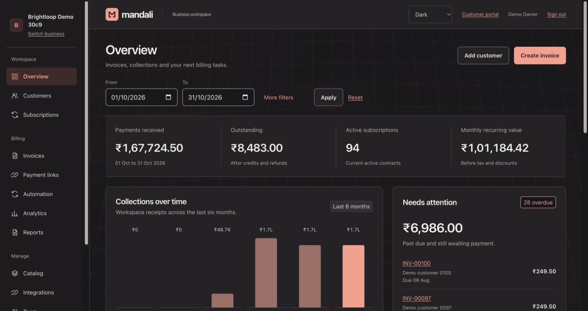
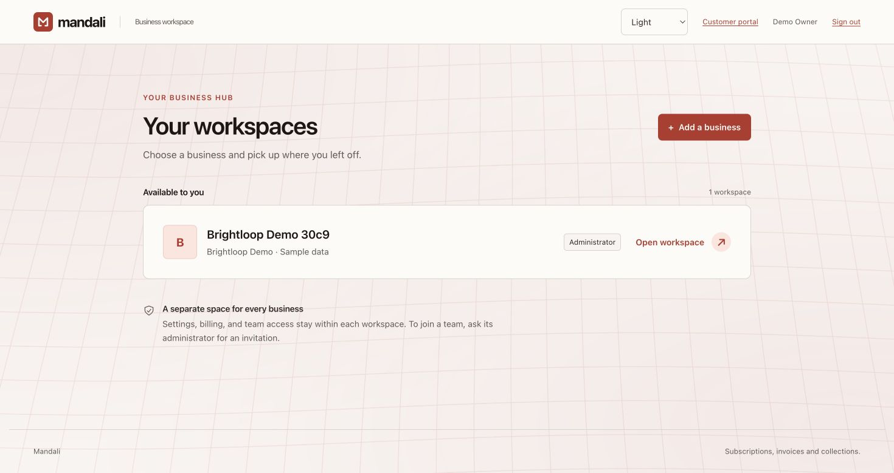
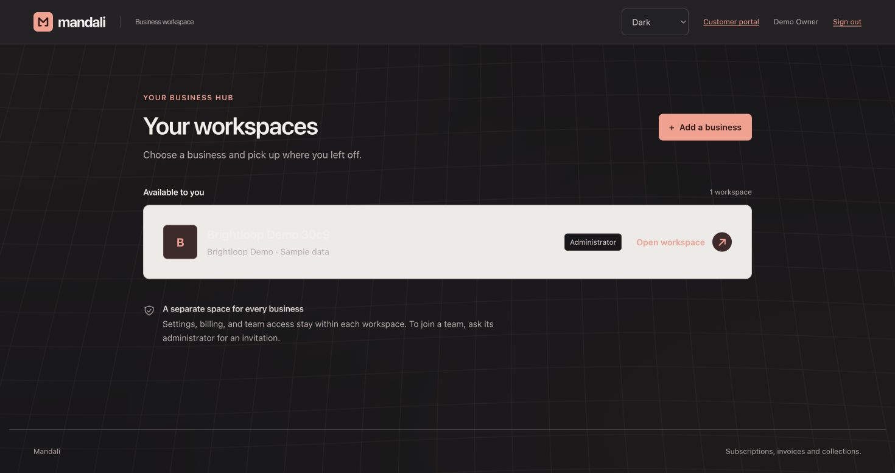
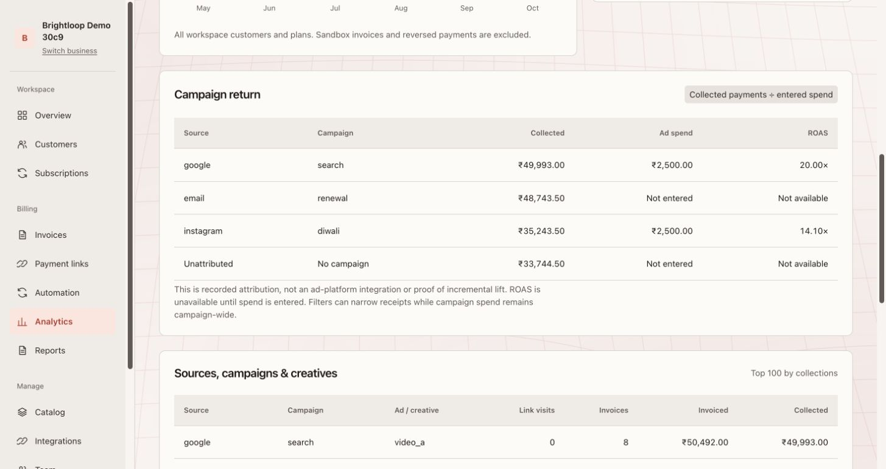
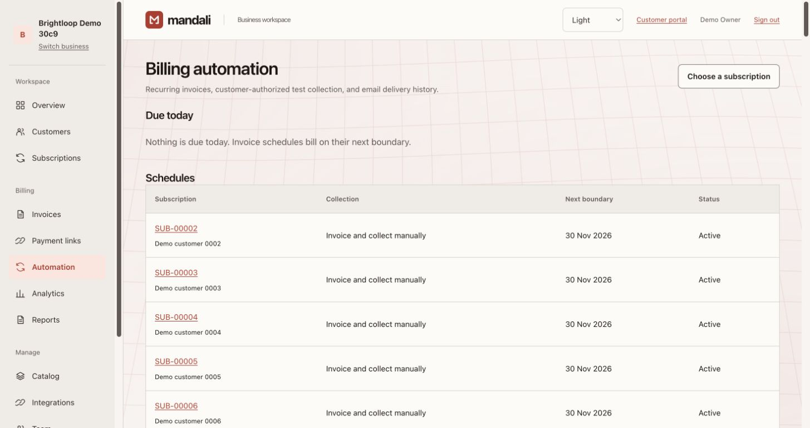
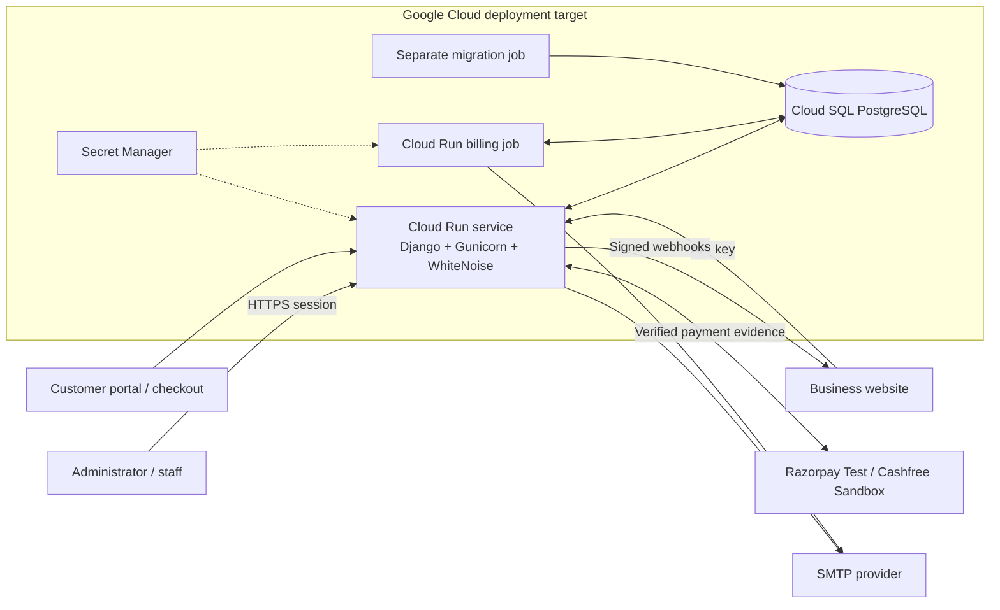

<p align="center">
  
</p>
<h1 align="center">Mandali</h1>
<p align="center"><strong>One workspace. Every subscription. A clearer view of your business.</strong></p>
<p align="center">Subscription management, GST-ready invoicing, recurring billing, and acquisition analytics for Indian businesses—with or without a website.</p>
<p align="center">
  <a href="https://github.com/Roky777/Mandali/actions/workflows/ci.yml"></a>
  
  
  
  
</p>
<p align="center">
  <a href="#product-tour">Product tour</a> · <a href="#run-locally">Run locally</a> · <a href="#five-minute-walkthrough">Walkthrough</a> · <a href="#architecture">Architecture</a> · <a href="docs/README.md">Documentation</a>
</p>



## Why Mandali

Subscription businesses often manage customers in one spreadsheet, invoices in another, payment links elsewhere, and renewals from memory. That makes it difficult to answer two basic questions: **who needs attention, and what is bringing in revenue?**

Mandali connects the customer, subscription, invoice, payment, and acquisition source in one business workspace. A shop without a website can share a link or QR code. An online business can send orders through the API. Staff can still enter invoices and payments manually. These workflows use the same billing records and balance calculations.

Built around the **Subscription Management System / Brightloop Software** problem statement, with India-first defaults: INR, Asia/Kolkata time, GST details, UPI QR codes, and local payment gateway integrations.

## What you can do

| Area | Implemented capabilities |
| --- | --- |
| **Business and team** | Email/password accounts, password recovery, business onboarding, separate workspaces, administrator and staff access, invitations, and customer-scoped portal access. |
| **Catalog and plans** | Products, variants, sale prices and costs, recurring plan intervals, minimum quantities, availability dates, quotation templates, and payment terms. |
| **Subscriptions** | Drafts, quotations with validity, confirmation, activation, pause/resume, renewal, and closing, governed by plan policies. |
| **Billing and GST** | Server-calculated invoice lines, CGST/SGST or IGST, due dates, invoice numbering, print views, email, WhatsApp sharing, and UPI QR codes for the balance due. |
| **Discounts** | Fixed or percentage discounts, eligibility dates, minimums, product/subscription scope, and usage limits enforced during billing. |
| **Payments** | Manual payment records, partial balances, overdue reminders, bank CSV matching, receipts, credit notes, and refunds. |
| **Links and checkout** | Shareable links, QR codes, mobile checkout, Razorpay Test and Cashfree Sandbox adapters, payment verification, and explained gateway routing. |
| **Recurring automation** | Scheduled invoices, billing preview, manual generation of today's invoices, unique billing periods, reminders, renewals, and authorized provider-managed test collection. |
| **Customer portal** | Single-use email-link access to the customer's own subscriptions and documents, with available actions controlled by plan policy. |
| **Revenue analytics** | Collections, outstanding balances, monthly recurring value, six-month trends, a three-month outlook, aging, and actionable overdue queues. |
| **Acquisition analytics** | UTM source, medium, campaign, and ad content; recorded campaign spend; attributed revenue and ROAS to compare acquisition channels. |
| **Website integration** | Business API keys, idempotent ingestion endpoints, signed outbound webhooks with retries, and customer synchronization with a preview. |

Acquisition reports use the attribution and spend recorded in Mandali. They are not an automatic connection to advertising networks or a claim of causal attribution. Gateway recommendations use configured eligibility and routing rules rather than a guaranteed lowest-cost or highest-success prediction.

## Product tour

### A focused start for every business

Choose a workspace, see your role, and enter the business you want to manage. The business picker keeps account navigation separate from day-to-day billing.

| Light | Dark |
| --- | --- |
|  |  |

### See the money and the next action

The overview pairs business totals with collections history and overdue work. Analytics connects sales to their recorded campaign, source, and ad content.

| Overview | Acquisition and revenue |
| --- | --- |
|  |  |

### Follow billing from subscription to payment

| Invoice ledger | Subscription lifecycle |
| --- | --- |
|  |  |
| **Track the amount due**, document details, payments, and adjustments. | **Manage the contract**, its plan policies, and billing actions. |

| Invoices | Reports |
| --- | --- |
|  |  |

<details>
<summary><strong>Revenue detail, automation, and mobile views</strong></summary>




<p align="center"></p>

</details>

**Current interface:** warm paper and coral in light mode; warm charcoal and coral in dark mode. The header offers **Light, Dark, or System**, saves the choice, and applies it across the workspace and public pages. The mesh gently bends around the pointer, respects reduced-motion preferences, and pauses when the tab is hidden. Printed documents use a light palette.

Screenshots were refreshed from the running local application on **31 October 2026** using generated sample data. They show implemented screens; they are not design mockups or evidence of live payment processing.

## Five-minute walkthrough

1. **Create your account and business.** Sign up, complete business details, and open the workspace. Add staff through Team when needed.
2. **Set up what you sell.** Add a product and recurring plan in Catalog. Add a customer, then prepare and confirm a subscription quotation.
3. **Issue an invoice.** Review lines, taxes, discount, and payment terms. Issue it, then inspect the balance and printable document.
4. **Collect and reconcile.** Record a partial manual payment and watch the balance change. With sandbox gateway credentials configured, create a payment link and inspect its QR and checkout.
5. **Automate and understand.** Configure recurring billing, preview due invoices, and review cycle history. Use Overview, Analytics, and Reports to inspect collections, attribution, and overdue work.

For the full problem-statement mapping and a more detailed demonstration, use the [requirements audit and walkthrough](docs/REQUIREMENTS_AUDIT.md).

## Run locally

**Requirements:** Python 3.12 or later and Git. SQLite is used for local development; production uses PostgreSQL.

```bash
git clone https://github.com/Roky777/Mandali.git
cd Mandali
python3 -m venv .venv
source .venv/bin/activate
pip install -r requirements.txt

export DJANGO_DEBUG=1
export MANDALI_BASE_URL=http://127.0.0.1:8000
export PAYMENT_ENCRYPTION_KEYS="$(python -c 'from cryptography.fernet import Fernet; print(Fernet.generate_key().decode())')"

python manage.py migrate
python manage.py runserver
```

Open [127.0.0.1:8000/signup/](http://127.0.0.1:8000/signup/), create an account, and add a business. Development emails—including password resets, invitations, and portal links—appear in the server terminal.

Keep your generated encryption key in your local environment and reuse it on later runs; changing it prevents decryption of credentials saved under the previous key. Do not commit it. The [.env.example](.env.example) lists supported settings; Django does **not** automatically load that file. Gateway checkout requires your own sandbox credentials.

### Explore with sample data

Create your account first, then run:

```bash
python manage.py seed_demo --email=YOUR_ACCOUNT_EMAIL --count=100
```

This adds a separate sample business to that existing account. It creates generated customers, subscriptions, invoices, and payments; it does not create or change a password. For a larger dataset, use `--count=5000`. Demo schedules are disabled and customer addresses use `example.invalid`.

## Architecture

Mandali is a **modular Django monolith**: server-rendered pages, session authentication, an integration API, and payment webhooks share a single application and data model. A separate worker invocation handles scheduled billing. This keeps tenant boundaries, invoice calculations, and payment rules in one place.



| Module | Responsibility |
| --- | --- |
| `core/` | Accounts, workspaces, roles, invitations, security headers, health endpoints, and shared interface. |
| `billing/` | Customers, catalog, plans, subscriptions, invoice ledger, discounts, adjustments, and acquisition analytics. |
| `checkout/` | Payment links, QR codes, gateway adapters, verification, and routing. |
| `recurring/` | Schedules, unique billing cycles, reminders, renewals, and authorized test collection. |
| `portal/` | Customer sign-in and customer-owned records. |
| `reports/` | Financial summaries, aging, work queues, activity, and exports. |
| `integrations/` | API keys, ingestion, outbound webhooks, and website sync. |
| `operations/` | Ledger checks, data maintenance, and structured request logging. |
| `templates/`, `static/` | Server-rendered screens, design tokens, theme selection, logo, and interactive mesh. |
| `scripts/`, `deploy/` | Google Cloud deployment helpers, image checks, and example configuration. |

### Rules that protect the ledger

- **Workspace isolation:** records are scoped to business membership; changing a URL does not grant another business's access. Customer portal access is scoped to the customer.
- **Server-owned totals:** money uses Decimal precision, and prices and tax details are copied onto invoice lines. Corrections to issued invoices use credit notes and refunds.
- **Checked transitions:** subscription actions are validated against the plan policy on the server, as are role-restricted operations.
- **Concurrent money updates:** conditional database updates and constraints guard against excess payments, credits, and refunds.
- **Idempotent billing:** a unique schedule/period cycle prevents a repeated billing run from generating the same period twice.
- **Verified gateway evidence:** signatures, amount, currency, order identity, and duplicate events are checked before a gateway payment is recorded.
- **Controlled integrations:** API keys, idempotency, signed webhook delivery, retries, and public-address checks protect integration boundaries.

```text
Invoice balance = total − credit notes − (payments − refunds)
```

## Google Cloud deployment

The deployment target is **Cloud Run + Cloud SQL PostgreSQL**, initially in **Mumbai (`asia-south1`)**, with Secret Manager, a separate migration job, and a scheduled billing job. The Docker image runs as a non-root user; WhiteNoise serves collected static assets. Business data stays in PostgreSQL rather than the container filesystem.

Start with the [Google Cloud deployment guide](docs/GOOGLE_CLOUD.md) and [example configuration](deploy/google-cloud/config.example.json). The guide covers required services, database roles, secrets, builds, migrations, releases, health checks, and email configuration. Cloud resources and provider credentials must be provisioned separately; repository configuration alone does not deploy them.

## Verification and operations

| Command or evidence | Purpose |
| --- | --- |
| `python manage.py check` | Validate Django configuration. |
| `python manage.py test` | Run automated tests. |
| `python manage.py check_ledger` | Reconcile invoice totals with payments, credits, refunds, and gateway evidence. |
| `python manage.py run_recurring` | Process scheduled billing; configure its production job as documented. |
| `python manage.py deliver_webhooks` | Retry due website webhook deliveries. |
| `python manage.py prune_operational_data --dry-run` | Preview expired operational data cleanup. |
| [CI workflow](.github/workflows/ci.yml) | Python 3.12/3.14 and SQLite/PostgreSQL test matrix, with deployment checks defined in the workflow. |
| [Requirements audit](docs/REQUIREMENTS_AUDIT.md) | Trace problem-statement requirements to implementation and manual checks. |
| [Release preparation](docs/RELEASE.md) | Operational checks, review scope, and remaining production verification. |

Provider integrations currently target test/sandbox environments. Real payment processing, infrastructure restore exercises, and production performance need verification in the deployed environment. A generated dataset is not a load-test result. The linked security review describes its own scope and is not an independent certification.

## Documentation

| Guide | What to find |
| --- | --- |
| [Documentation index](docs/README.md) | Task-based guides and the code map. |
| [Foundation](docs/FOUNDATION.md) | Accounts, onboarding, roles, and workspace access. |
| [Billing](docs/BILLING.md) | Catalog, quotations, subscriptions, taxes, discounts, and payments. |
| [Checkout](docs/CHECKOUT.md) | Payment links, QR codes, and Razorpay Test. |
| [Recurring billing](docs/RECURRING.md) | Billing cycles, reminders, renewals, and authorized collection. |
| [Gateway routing](docs/GATEWAY_ROUTING.md) | Cashfree Sandbox, recommendations, and routing decisions. |
| [Website and API](docs/INTEGRATIONS.md) | API reference, synchronization, and webhooks. |
| [Portal and reports](docs/PORTAL_AND_REPORTS.md) | Customer self-service, documents, adjustments, and exports. |
| [Google Cloud](docs/GOOGLE_CLOUD.md) | Production infrastructure and deployment steps. |
| [Design](docs/DESIGN.md) | Interface decisions, themes, and screenshot references. |

## Design and review references

[Hallmark](https://github.com/nutlope/hallmark) informed interface structure and visual reviews. [Cloudflare's security-audit skill](https://github.com/cloudflare/security-audit-skill) informed focused security review work, documented in [release preparation](docs/RELEASE.md). These references describe tools used during development, not an affiliation or endorsement.
