# Mandali

**Subscription billing, invoicing, and payments for Indian businesses, with or without a website.**

[](https://github.com/Roky777/Mandali/actions/workflows/ci.yml)


Mandali puts plans, quotations, subscriptions, GST-ready invoices, payments, and revenue reports in one workspace. A business can bill by hand, share payment links and QR codes, or connect its website through an API. All three channels write to the same ledger.

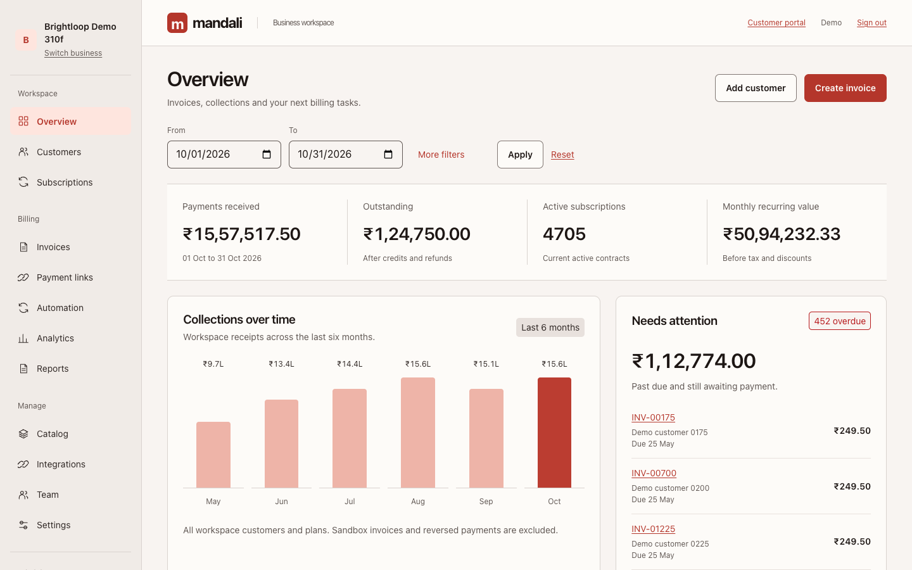

> Built for the *Subscription Management System* problem statement (the Brightloop Software scenario): replace spreadsheets, manual invoices, and missed renewals with one reliable system.

## Highlights

| | |
| --- | --- |
| **Subscriptions** | Plans that bill daily, weekly, monthly, or yearly, with minimum quantities, availability dates, and pause, close, renew, and auto-close policies. Quotation templates with validity periods. The lifecycle runs Draft → Quotation → Confirmed → Active ⇄ Paused → Closed. |
| **Invoices** | Prices and taxes copied onto every line, with a CGST + SGST or IGST split. Due dates come from payment terms. Email, print, or share on WhatsApp, with a UPI QR for the amount due. Credit notes and receipts. |
| **Automation** | A recurring billing worker that bills each period exactly once, even when run twice, plus a **Generate today's invoices** button with a preview. Discounts apply automatically, and usage limits are enforced in the same transaction. Reminders, renewals, and expiry. |
| **Payments** | Offline payments with partial balances, overdue reminders, and bank statement CSV matching. Hosted checkout with payment links and QR codes on **Razorpay Test** and **Cashfree Sandbox**, with explained, rule-based gateway routing. |
| **Customers** | A self-service portal reached by a single-use email link. Customers see only their own invoices, receipts, credit notes, and subscriptions, and can pause, resume, renew, or close where the plan allows. |
| **Analytics** | Revenue and acquisition: which campaign, ad, and source brought each sale (UTM tags), ad spend and ROAS, MRR, a six-month collection trend, a three-month outlook, aging buckets, and a list of work that needs attention. |
| **Website/API** | Business API keys, idempotent endpoints for customers, orders, and subscriptions, signed webhooks with retries, and a previewed customer sync. |
| **Trust** | Isolated business workspaces, Administrator / Staff / Customer roles enforced on every request, Decimal money with database constraints, a ledger self-check, and structured logs. |

## Screens

| | |
| --- | --- |
| 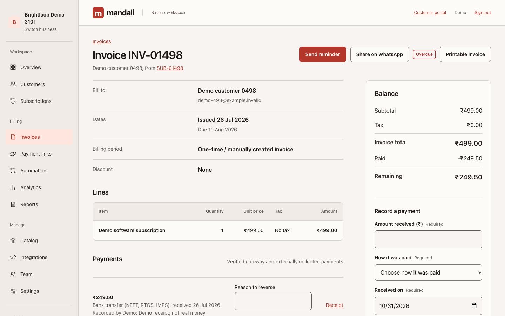 | 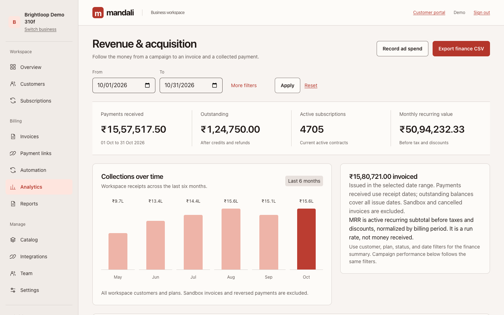 |
| **Invoice:** GST split, balance ledger, reminders, UPI and WhatsApp | **Analytics:** where revenue comes from, and what is working |
| 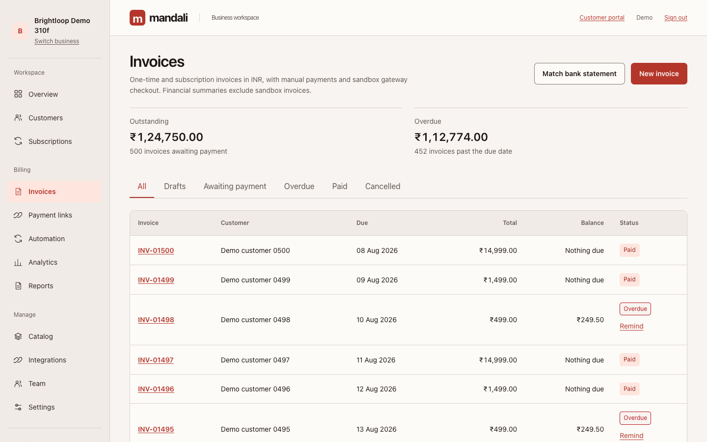 | 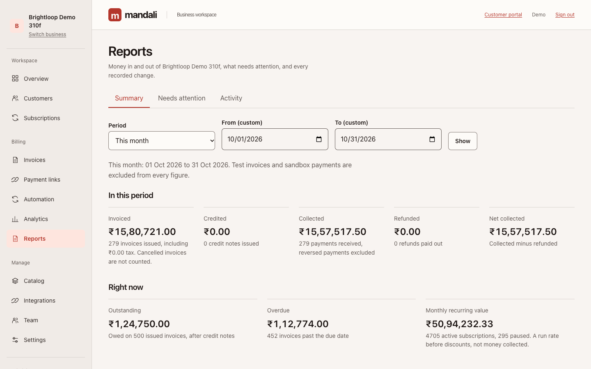 |
| **Invoices:** filters, overdue tags, Remind, bank matching | **Reports:** every figure states what it counts |
| 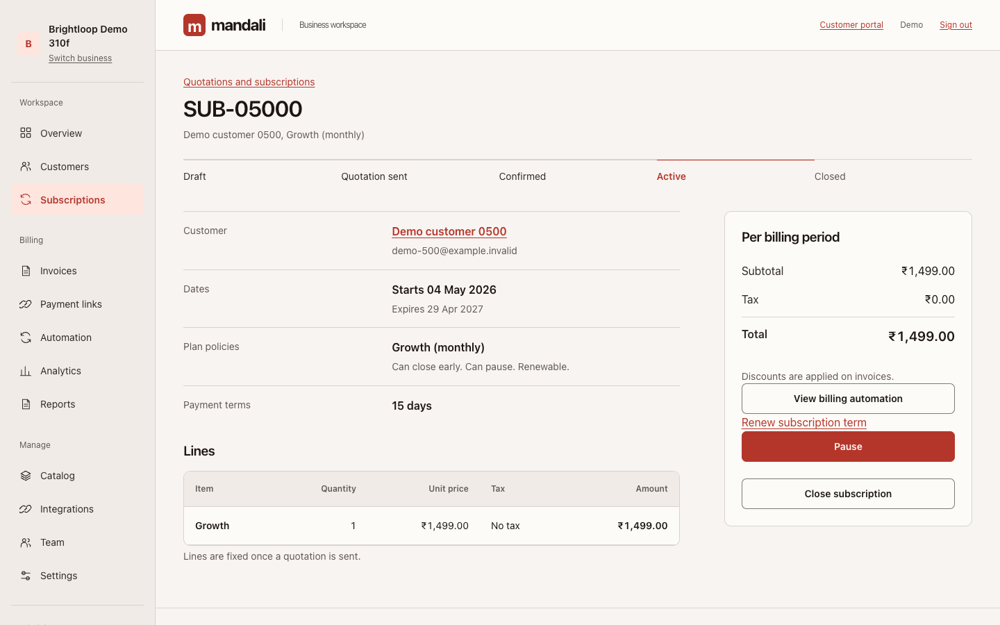 | 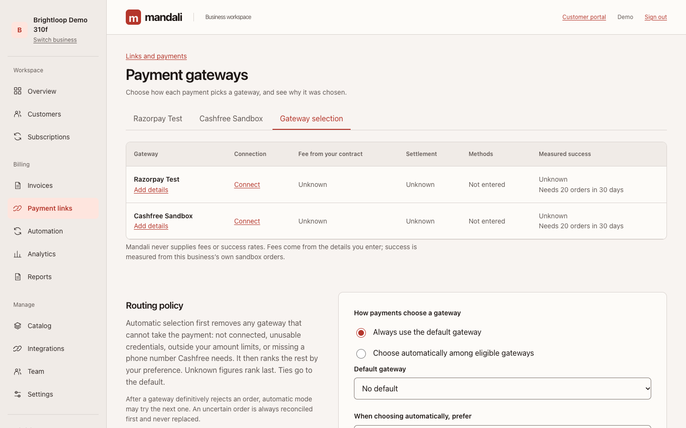 |
| **Subscription:** lifecycle and plan policies | **Gateway selection:** explained routing between two gateways |

<p align="center">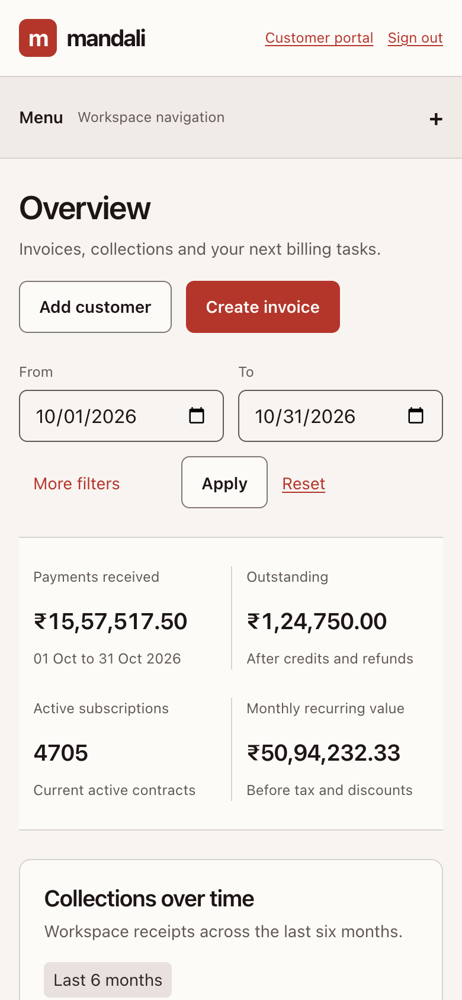</p>

All screenshots use generated demo data.

## Architecture

Mandali is a modular Django monolith. One service renders the interface, serves the API, and receives gateway webhooks. A separate worker runs recurring billing.

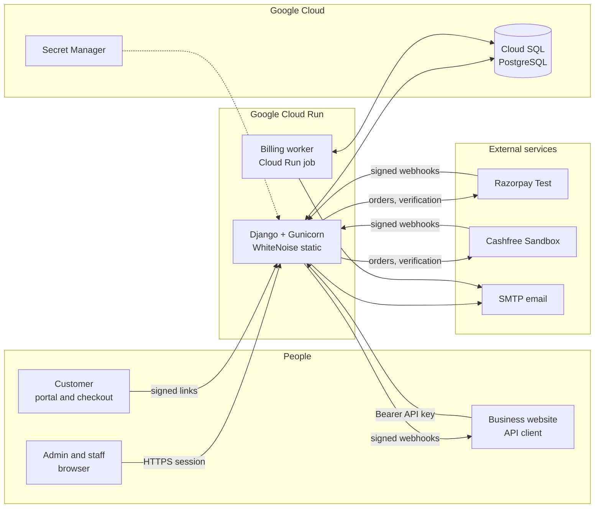

### Apps

| App | Responsibility |
| --- | --- |
| `core` | Accounts, password rules and recovery, workspaces, memberships and roles, invitations, rate limits, security headers |
| `billing` | Customers, catalog, plans, quotations, subscriptions, invoices, taxes, discounts, payments, credit notes, refunds, analytics |
| `recurring` | Billing schedules, the idempotent cycle worker, reminders, renewals, authorized test collection |
| `checkout` | Payment links, QR codes, hosted checkout, Razorpay and Cashfree adapters, gateway routing |
| `portal` | Customer email-link sign-in and self-service |
| `reports` | Finance summary, aging, needs-attention queue, activity history, CSV exports |
| `integrations` | API keys, ingestion API, outbound webhooks, website sync, outbound request safety |
| `operations` | Ledger check, data pruning, structured request logging, pilot allowlist |

### Subscription lifecycle

Every transition is checked on the server against the plan's policy, so a hidden button can't be bypassed.

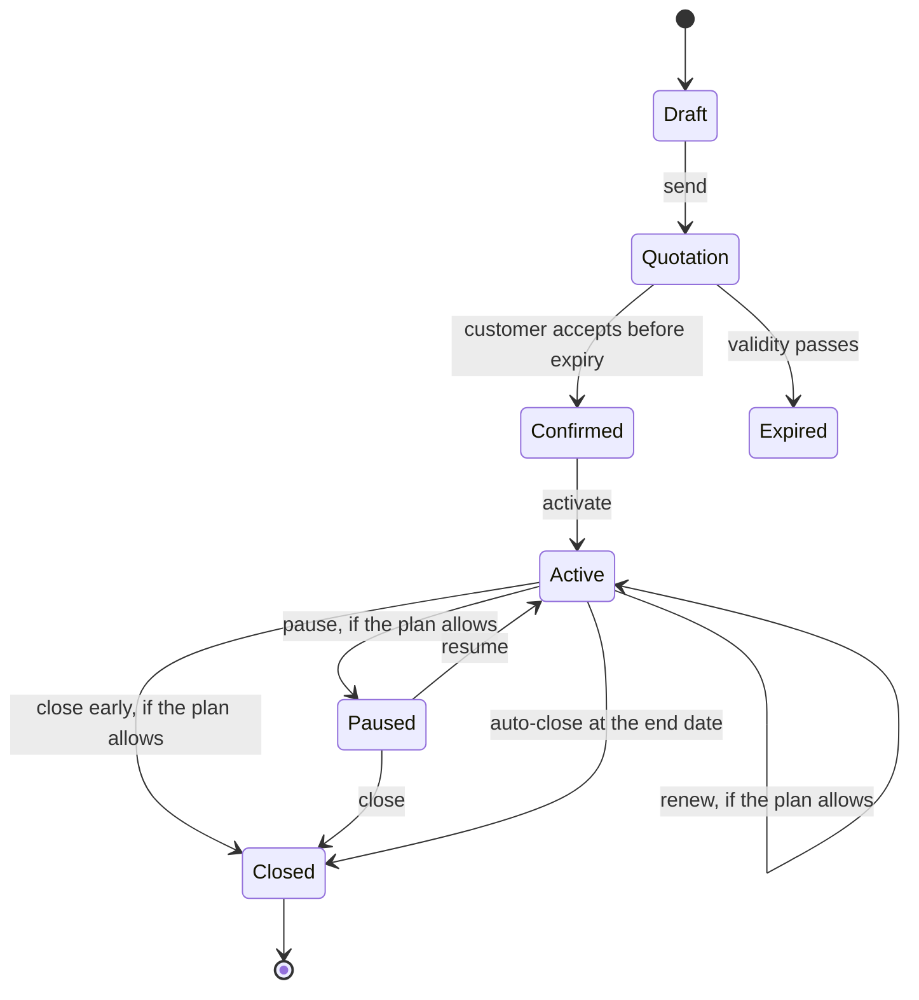

### Invoice lifecycle and money rules

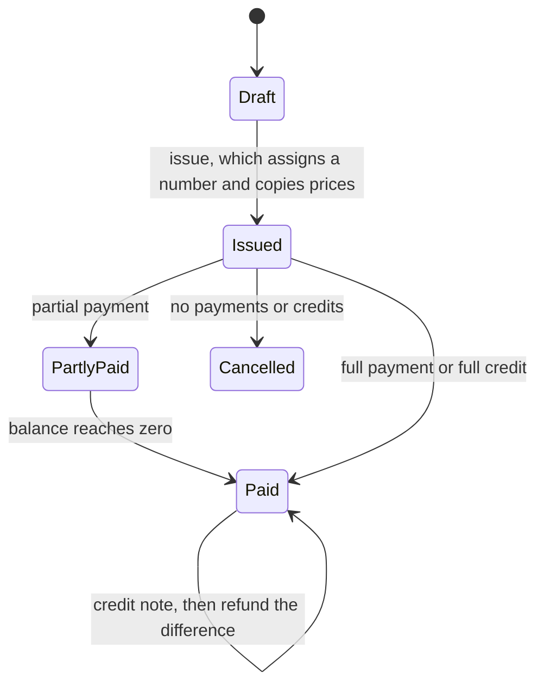

`balance = total − credit notes − (payments − refunds)`. Each payment, credit, and refund is checked and applied by one conditional database update, so concurrent requests can't overpay, over-credit, or over-refund. A database constraint backs this up.

### Paying through a link or QR code

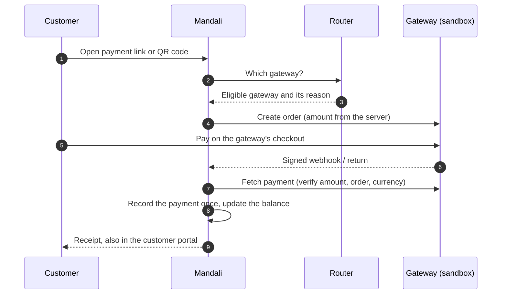

### Recurring billing, exactly once

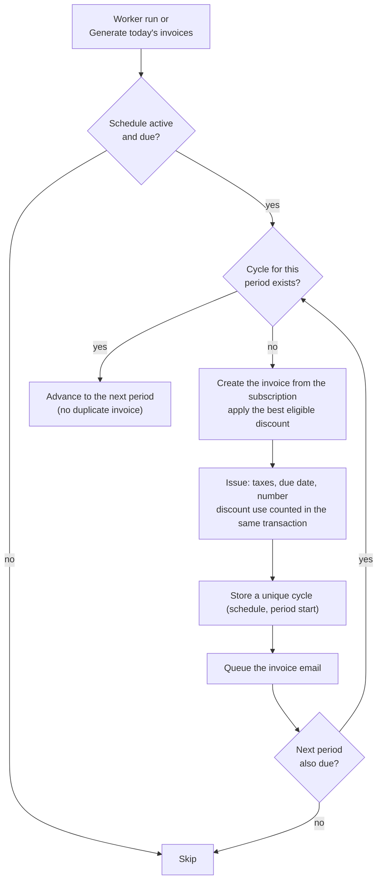

### Core data model

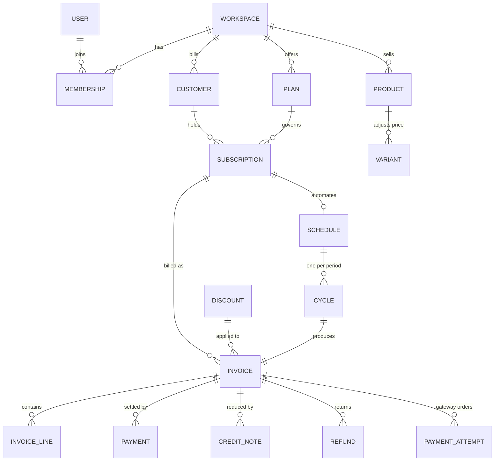

## Built to be trusted

- **Isolation:** every business is a separate workspace. Every query is scoped to the signed-in member's workspace, and a record ID from another business returns 404.
- **Roles:** Administrator, Staff, and Customer are enforced on the server, on every request. Only administrators add staff, configure the catalog, issue credit notes, or change gateways.
- **Money:** Decimal amounts with paise precision. Totals are always calculated on the server, and prices and taxes are copied onto each line. Issued invoices are never edited; corrections use credit notes and refunds.
- **Payments:** only a verified gateway capture records a payment. Webhooks are signature-checked and deduplicated. An uncertain gateway order is reconciled, never replaced with a second charge.
- **Abuse limits:** rate limits on sign-in, signup, password reset, portal links (per IP and per recipient), checkout, and the API.
- **Outbound safety:** webhooks and website sync only reach public HTTPS addresses, pinned to the checked IP, with no redirects. Private and cloud metadata addresses are refused.
- **Operations:** `check_ledger` verifies that every invoice's totals match its documents. Logs never contain URL tokens. A pilot allowlist controls who can sign up.

A partial security review using [Cloudflare's security-audit skill](https://github.com/cloudflare/security-audit-skill) found and fixed one low-severity issue; see [release preparation](docs/RELEASE.md). The review was not independently verified and is not a certification.

## Quick start

Requirements: Python 3.12 or later.

```bash
git clone https://github.com/Roky777/Mandali.git
cd Mandali
python3 -m venv .venv && source .venv/bin/activate
pip install -r requirements.txt

export DJANGO_DEBUG=1
# Needed for payment links and gateway credentials:
export PAYMENT_ENCRYPTION_KEYS=$(python -c 'from cryptography.fernet import Fernet; print(Fernet.generate_key().decode())')

python manage.py migrate
python manage.py runserver
```

Open http://127.0.0.1:8000/signup/, create an account, then set up a business. In development, emails (invitations, resets, portal links, reminders) print to the terminal.

### Demo with 5,000 subscriptions

```bash
python manage.py seed_demo --email=YOUR_ACCOUNT_EMAIL --count=5000
```

This creates a separate sample workspace with generated customers, invoices, and payments. Its schedules are disabled, and its customer emails use `example.invalid`.

### Useful commands

| Command | What it does |
| --- | --- |
| `python manage.py test` | Run the test suite |
| `python manage.py check_ledger` | Verify that invoices, payments, credits, refunds, and gateway evidence agree |
| `python manage.py prune_operational_data --dry-run` | Preview removal of expired operational data |
| `python manage.py deliver_webhooks` | Retry website webhook deliveries that are due |

## Deployment

The target is **Google Cloud Run + Cloud SQL PostgreSQL**, with Secret Manager for secrets and a separate migration job. Production refuses to start on SQLite or without its secrets. See the [Google Cloud guide](docs/GOOGLE_CLOUD.md).

## Documentation

| Guide | Covers |
| --- | --- |
| [Foundation](docs/FOUNDATION.md) | Accounts, roles, workspaces, security settings |
| [Manual billing](docs/BILLING.md) | Catalog, quotations, invoices, discounts, payments |
| [Checkout](docs/CHECKOUT.md) | Payment links, QR codes, Razorpay Test |
| [Website and API](docs/INTEGRATIONS.md) | API reference, webhooks, website sync |
| [Recurring billing](docs/RECURRING.md) | Schedules, the worker, reminders, authorized collection |
| [Gateway routing](docs/GATEWAY_ROUTING.md) | Cashfree, recommendations, automatic routing |
| [Portal and reports](docs/PORTAL_AND_REPORTS.md) | Customer portal, credit notes, refunds, reports |
| [Release preparation](docs/RELEASE.md) | Security review, operations, manual checks |
| [Requirements audit](docs/REQUIREMENTS_AUDIT.md) | Problem-statement coverage and walkthrough |
| [Design](docs/DESIGN.md) | Interface direction with [Hallmark](https://github.com/nutlope/hallmark) |

## Status

- [x] Foundation: accounts, roles, workspaces
- [x] Manual billing core
- [x] Payment links, QR codes, Razorpay sandbox
- [x] Website/API integration
- [x] Recurring billing and automation
- [x] Gateway recommendations and routing (Cashfree)
- [x] Customer portal, reports, refunds
- [ ] Release: live gateway verification, a backup restore drill, and a load test on production infrastructure

Payments currently run in sandbox mode only. No real money moves.
