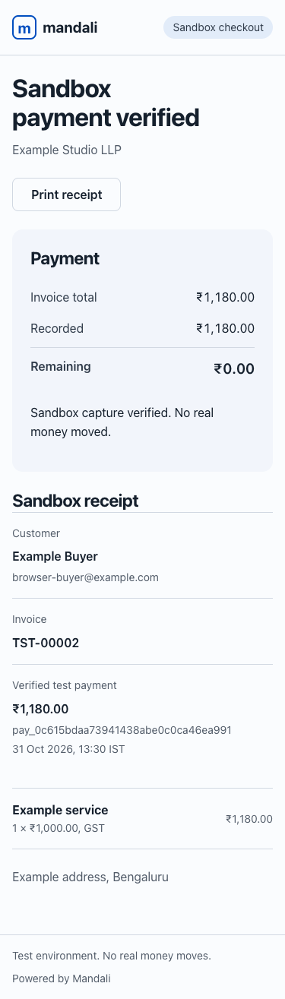

# Part 3: Links, QR codes, and sandbox payments

Mandali hosts a mobile checkout for a product, a plan's initial payment, or an issued sandbox invoice. Staff creates expiring links under **Payments**, opens or shares the URL, and downloads its QR as SVG. The QR opens the same checkout; it is not a native UPI payment QR. Links expire after 1–90 days and can be revoked immediately. Treat URLs as bearer credentials and share invoice links only with their intended buyer.

## Configure a test gateway

Only Razorpay **Test** keys (`rzp_test_…`) are accepted here. Part 6 adds Cashfree Sandbox and gateway routing; see [gateway routing](GATEWAY_ROUTING.md). Live collection, refunds, and automatic renewal are later parts. Test transactions create separate `TST` invoices and are excluded from the financial dashboard and real discount usage. Sandbox billing events do not send website fulfillment webhooks. API invoice representations include `is_sandbox` for clarity. An invoice created manually must have **Sandbox invoice** selected before issuing it to use checkout.

1. Install requirements and run `python manage.py migrate` as in the main setup guide.
2. Generate a dedicated encryption key locally with `python -c 'from cryptography.fernet import Fernet; print(Fernet.generate_key().decode())'`. Keep it private. Set `PAYMENT_ENCRYPTION_KEYS` to that key in the server environment; there is no default. Set `MANDALI_BASE_URL` to the exact public origin (HTTPS in production). Existing links and credentials cannot be decrypted if the key is lost.
3. As the workspace administrator, open **Payments → Gateway settings**. Save a Razorpay Test key ID, its test secret, and a separate random webhook secret of at least 16 characters. Secrets are encrypted in the database, never returned to the browser, and scoped to this workspace.
4. In Razorpay's Test dashboard, enable automatic capture and add the webhook URL shown in Mandali with the same webhook secret. Subscribe to `payment.captured`, `payment.authorized`, and `payment.failed`. The HTTPS endpoint must be reachable by Razorpay. Use provider test payment details only.
5. Create a product or plan link, or issue a sandbox invoice and create its payment link. Open it as a buyer, enter billing details, review the server-calculated invoice, and prepare a test payment. Only a verified capture records a payment. Authorization alone remains pending.

See Razorpay's [server integration guide](https://razorpay.com/docs/payments/server-integration/python/integration-steps/) and [webhook validation guide](https://razorpay.com/docs/webhooks/validate-test/). Payment methods and test-account access depend on the provider account; Mandali does not promise merchant eligibility or enable a payment method itself.

## Google Cloud configuration

Store the encryption key in Secret Manager. Grant only the runtime service account access to this secret, then set `payment_encryption_secret` in the deployment config to `secret-name:NUMERIC_VERSION`. The staging helper binds it as `PAYMENT_ENCRYPTION_KEYS` on the web service, never the migration job. See [Google Cloud deployment](GOOGLE_CLOUD.md). Do not put key values in deployment JSON, GitHub, screenshots, or support messages.

For rotation, the environment accepts comma-separated Fernet keys: the first encrypts new values and all retained keys can decrypt. Retain old keys until all stored gateway credentials and link tokens have been re-encrypted through a separately reviewed migration; there is no automatic re-encryption command in this part. Back up keys separately from the database.

Changing gateway credentials creates a new account version. Preserve old provider credentials and webhook endpoints while old orders settle. Disabling a gateway stops new orders; evidence for existing orders can still be verified with its retained configuration.

## Verification and reconciliation

- A signed, 15-minute quote token binds the item and current price. Repeated submission creates one checkout session and invoice. Sessions/receipt URLs expire after two hours; reopen the original link to continue, or ask staff for a receipt.
- Each invoice has at most one unresolved order. Preparing a payment again reuses that order. A creation timeout remains **uncertain**; it never automatically creates a replacement charge.
- Administrators can locate an uncertain order in Razorpay Test using the attempt UUID without hyphens as the order receipt. Enter its order ID in Payments and reconcile. Mandali verifies receipt, attempt notes, currency, and amount before adopting it.
- Browser callbacks use the stored order ID for signature verification. Webhooks verify the raw request body before processing. Both fetch authoritative payment evidence from Razorpay and require a captured INR payment matching the reserved amount and order. Callback/webhook retries are deduplicated transactionally.
- Revocation stops new starts; it does not erase a payment already started at the provider. Webhooks can still reconcile that evidence after link/session expiry.
- Overpayments, refunded captures, duplicate references, and conflicts with manual payments go to **Needs review**. No second ledger entry is silently added. Online payments cannot be reversed with the offline-payment action. Refund handling is deferred to Part 7.
- No card details or raw webhook bodies are retained. The provider checkout script loads only on a prepared public payment session. Customers do not receive access to any other customer or invoice.

## Validation and limits

The automated suite uses mocked provider responses for signature failures, retries, uncertain orders, captured/authorized states, tenant isolation, credential rotation, and ledger deduplication. Browser QA uses a separate local fixture server and dummy SDK; these fixtures are not shipped. A real Razorpay Test transaction and webhook delivery still need verification using the merchant's test account on the deployed HTTPS service. This is not live-payment readiness or a full security audit.

Plan links collect an initial payment only and do not create an active recurring subscription or mandate. Catalog checkout collects billing details; an invoice-specific bearer link exposes that invoice's existing snapshots after checkout. Tax calculations reuse Part 2 and do not claim GST invoice compliance.

## Screenshots

Dummy business and buyer data; the payment provider was a local fixture.

[Desktop buyer checkout](screenshots/checkout-desktop.png).
