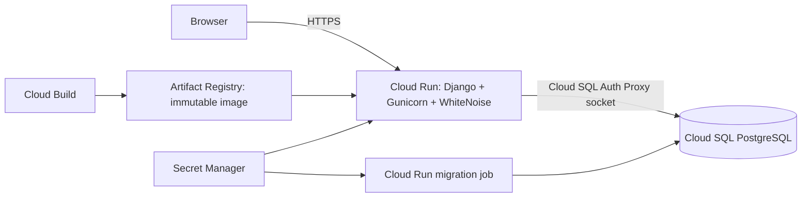

# Google Cloud deployment

Google Cloud is Mandali's deployment target. The application remains a modular Django monolith: the interface, authentication, authorization, and later billing modules ship together. There is no separate GitHub Pages, Vercel, Supabase, or Render deployment in this implementation.

## Architecture



Use `asia-south1` (Mumbai) for the app, database, and image registry initially. Cloud Run's managed HTTPS endpoint serves both pages and static files. WhiteNoise serves compressed, fingerprinted assets collected at image build time. A reverse proxy or separate static frontend is unnecessary for this stage.

The application uses Cloud Run's built-in Cloud SQL Auth Proxy attachment at `/cloudsql/PROJECT:REGION:INSTANCE`. This deployment path uses Cloud SQL's public-IP connector path, with no authorized public client networks; IAM authorizes the connector and encrypts its remote hop. It does not expose an unauthenticated database. Private-IP-only networking is a separate infrastructure change requiring Direct VPC egress and a private-IP connector; do not simply remove the instance's public IP from this configuration.

User accounts, business records, memberships, rate limits, and sessions live in PostgreSQL. No business data belongs on Cloud Run's disposable local filesystem. The current image does not support user uploads. When invoice documents/uploads arrive, add a private Cloud Storage bucket with authorized downloads; do not save those files inside the container.

## What this change provides

- A non-root Python 3.12 container with Gunicorn listening on Cloud Run's `PORT`.
- PostgreSQL settings with Cloud SQL socket support and explicit credentials.
- A local-only SQLite fallback when `DJANGO_DEBUG=1`. Production refuses missing PostgreSQL configuration.
- Strong secret-key and canonical-origin validation, derived allowed hosts, secure cookies, and opt-in Cloud Run proxy trust.
- Secret Manager references at deployment time; no runtime secrets in the image or repository.
- A single-task migration job and separate runtime/migration identities.
- `/health/live/` (process) and `/health/ready/` (database connection), with generic failure responses.
- A build configuration, staged-release helper, and CI tests for SQLite, PostgreSQL, and the production container.

No project, service, database, IAM binding, or secret has been created by preparing these files. Actual deployment needs your Google Cloud project, billing, and authenticated access.

## 1. Prepare a project and backing services

Run commands from Google Cloud Shell or a machine with `gcloud` authenticated to the intended project. Use separate development and production projects before real customer billing. Prefer short service/instance names so the Cloud SQL socket path fits the operating system's socket-length limit.

Enable the Cloud Run, Cloud SQL Admin, Cloud Build, Artifact Registry, and Secret Manager APIs. In the console, create:

1. A Docker Artifact Registry repository named `mandali` in Mumbai.
2. A PostgreSQL 16 Cloud SQL instance named `mandali-db` in Mumbai, and a database named `mandali`. Enable automated backups, point-in-time recovery, storage monitoring, and deletion protection. Use regional high availability for real billing; a smaller zonal development instance can reduce development cost. Cloud SQL is a paid service.
3. Two service accounts: `mandali-app` and `mandali-migrations`. Grant each Cloud SQL Client access. Do not use the default broad-permission service account or upload a service-account JSON key.
4. The database roles and grants from [database-grants.sql](../deploy/google-cloud/database-grants.sql), run as the database administrator **inside the mandali database**. This first-time script creates SQL roles directly so they do not inherit `cloudsqlsuperuser`. Set a distinct strong password on each role through the Cloud SQL Users interface, then store each password in Secret Manager. The runtime role receives data/sequence access; only the migration role owns the schema. Do not grant either role broad Cloud SQL administrator privileges. Run the script once; it is not an idempotent migration.
5. Four Secret Manager secrets: a Django secret key of at least 50 random characters, the runtime database password, the migration database password, and an SMTP password. Set secret-level Secret Accessor permissions: the app account gets only the Django/runtime-DB/SMTP secrets; the migration account gets only the Django/migration-DB secrets.
6. An SMTP provider and verified sender. Google Cloud hosting does not itself provide transactional email. The app defaults to TLS on port 587; verify real invitation and reset delivery before launch. SMTP credentials are required by the supplied deployment configuration.

The deployer needs permission to build images, manage Cloud Run services/jobs, and act as the two service accounts. The configured Cloud Build identity needs access to the uploaded source, Logs Writer, and Artifact Registry Writer on the image repository. Keep build/deployment authority separate from runtime authority.

Use a billing budget and alerts. Budgets notify; they are not hard spending caps. Container defaults cap each revision at five instances, with zero minimum instances. Multiple active/tagged revisions can consume more than one revision's allocation. Cloud SQL, builds, image storage, networking, and logs have separate usage/costs. No always-free claim is made.

## 2. Build an image without secrets

From the repository root:

```bash
gcloud builds submit --project YOUR_PROJECT_ID --config cloudbuild.yaml
```

The Dockerfile and its context allowlist include both current Django apps (`core` and `billing`). When adding another app, include its package in both files; the container CI check verifies that Django can load every installed app.

The image is tagged with the build ID and pushed to:

```text
asia-south1-docker.pkg.dev/YOUR_PROJECT_ID/mandali/web:BUILD_ID
```

Copy the resulting immutable digest from Artifact Registry. The release helper requires `.../web@sha256:DIGEST`, not `latest` or a mutable tag. The same image is used by the migration job and web service. The Docker build uses `config.build_settings` only to collect static files; it does not need a database, cloud credentials, or production secret key. Runtime always uses `config.settings`.

For a different region or registry name, override `_REGION` and `_REPOSITORY` in the Cloud Build substitutions and use matching deployment configuration.

## 3. Configure and stage the release

Copy [config.example.json](../deploy/google-cloud/config.example.json) to `deploy/google-cloud/config.local.json` and replace the public identifiers. The local file is ignored by Git and Cloud Build. It contains secret **names and numeric versions**, never passwords or private keys. A secret reference such as `mandali-django-secret:1` means version 1 of that named secret. Keep versions pinned for reproducible releases; do not use `latest`.

Leave `base_url` empty for the first deployment to use Cloud Run's assigned URL. For a configured custom domain, set it to the exact HTTPS origin. Host and CSRF settings are derived by the helper, including a staged candidate's URL when needed.

```bash
python3 scripts/deploy_google_cloud.py deploy/google-cloud/config.local.json
```

The helper:

1. Validates the project/region, image digest, separate identities, and pinned secret references.
2. Deploys a single-task migration job, runs it, and waits. It stops on failure, before releasing the web service. It never runs migrations in a web worker's startup path.
3. On the first deployment, creates an **IAM-private** service, discovers its URL, and updates the canonical URL automatically. The temporary bootstrap origin is never left as the final URL.
4. On subsequent deployments, stages a `candidate` revision with **no normal traffic**, leaving the old revision serving traffic.
5. Reports the actual service/candidate URLs and the ready revision name. It does not automatically publish the service or shift production traffic.

Run one deployment process at a time. The helper uses a stable migration-job name and does not provide a distributed deployment lock. New migrations must remain compatible with the currently serving application until promotion. A database migration is not undone by rolling back the web image; use expand/contract changes, backups, and a separate recovery plan for destructive migrations.

## 4. Verify, publish, and promote

Use an identity with Cloud Run Invoker to test a private initial service through the supported proxy:

```bash
gcloud run services proxy mandali --project YOUR_PROJECT_ID --region asia-south1 --port 8081
```

For an existing staged service, add `--tag candidate`. Check `/health/live/`, `/health/ready/`, and the login page/static assets. These endpoints reveal no database credentials. Use Cloud Run's default TCP startup check; an HTTP startup probe would need a valid Host and trusted HTTPS forwarding configuration. Do not restart healthy workers solely because PostgreSQL is briefly unavailable; readiness and process liveness are separate signals.

`DJANGO_TRUST_CLOUD_RUN_PROXY=1` is set only on the web service, where Cloud Run injects `K_SERVICE` and terminates HTTPS. It enables Django to honor the managed HTTPS proxy header. Never set this on a directly exposed container. The example starts `trusted_proxy_hops` at `0`, which ignores forwarded IPs. Before public launch, verify the real forwarding chain for your ingress, set the number of trusted rightmost appended hops, and stage again. Do not trust the leftmost caller-controlled forwarded value. Unconfigured proxy IP detection can combine users into one rate bucket, so verify independent clients during rollout. Adding a load balancer later requires rechecking this setting.

Once the initial service is ready for public browser access, grant public invocation explicitly (Django still controls account/workspace access):

```bash
gcloud run services add-iam-policy-binding mandali --project YOUR_PROJECT_ID --region asia-south1 --member=allUsers --role=roles/run.invoker
```

If organizational policy forbids public invocation, use your organization's approved ingress/authentication approach instead.

For a staged update, promote the exact revision printed by the helper:

```bash
gcloud run services update-traffic mandali --project YOUR_PROJECT_ID --region asia-south1 --to-revisions READY_REVISION_NAME=100
```

Test signup, staff invitation/acceptance, logout/login, reset email, and workspace isolation against the real domain using test accounts. Check that the new revision can read/write through the runtime database role. Consider setting minimum instances to one before measuring the two-second page target; cold starts with zero minimum instances are not a latency guarantee.

Retain the previous image and secret versions for rollback. Route traffic to a known-compatible previous revision when needed. Inspect Cloud Logging and Cloud SQL metrics after a release; set alerts for server errors, database connections/storage, and email failures. Restrict access/retention for request logs because invitation/reset paths can contain bearer tokens. Rotate secrets by creating new versions and staging a new release. Never post secrets in an issue, PR, screenshot, or chat.

## Connections and scaling

The image starts two workers with four threads each, so a revision can hold about eight persistent database connections per instance. Five instances give a baseline ceiling near 40, plus migration/admin connections. Rolling deployments and candidate revisions add to that number. Set Cloud SQL connection capacity and Cloud Run instance limits together. Connections are health-checked and recycled after 60 seconds. Do not increase scaling limits independently of database capacity.

Cloud Run revision and container filesystem changes never replace PostgreSQL migrations. Back up Cloud SQL and rehearse restoration before using real business data. The current foundation has no billing jobs. Add authenticated Cloud Tasks/Cloud Scheduler execution and idempotency when Part 5 introduces recurring billing; do not depend on web-instance memory or in-process timers.

## Webhook retries

Part 4 sends each webhook once, right after the billing change commits, from the web request. Retries need `python manage.py deliver_webhooks` to run on a schedule. The deploy helper does not create this yet. Create a Cloud Run job from the same image, runtime service account, Cloud SQL attachment, and pinned secrets as the web service, with the command `python manage.py deliver_webhooks`. Trigger it every five minutes from Cloud Scheduler using a dedicated identity that has only Cloud Run Invoker on that job. The command is safe to overlap: each delivery is leased with a conditional update before it is sent. Until the schedule exists, failed deliveries wait, and administrators can use **Send again** under Integrations.

Webhook and website-sync requests leave from Cloud Run's default egress. Mandali refuses private, link-local, and metadata-server addresses on its own; do not route egress through a VPC connector that would make internal services reachable without reviewing that change.

## Local and CI verification

```bash
export DJANGO_DEBUG=1
python manage.py collectstatic --noinput --settings=config.build_settings
python manage.py test
```

SQLite remains a local convenience. To exercise PostgreSQL locally, set `DB_HOST`, `DB_PORT`, `DB_NAME`, `DB_USER`, and `DB_PASSWORD`, leaving `CLOUD_SQL_CONNECTION_NAME` unset. With debug off, direct TCP PostgreSQL requires verified TLS; the Cloud SQL connector socket handles remote encryption itself.

CI runs the full suite on SQLite and PostgreSQL 16, with Python 3.12/3.14, and builds/starts the production container. Dummy container credentials deliberately have no database behind them: process liveness/login/static files must work, and database readiness must return a generic 503. Production system checks retain the documented HSTS subdomain/preload advisories until the deployment's complete domain coverage is known.

Actual Cloud Run/Cloud SQL/SMTP integration and the ingress hop count still require verification in your Google Cloud project. Local and CI checks cannot prove IAM, routing, secret access, mail delivery, or billing behavior in an unconfigured account.

## References

- [Google: Django on Cloud Run](https://docs.cloud.google.com/python/django/run)
- [Google: Cloud Run to Cloud SQL](https://docs.cloud.google.com/sql/docs/postgres/connect-run)
- [Google: Cloud Run container contract](https://docs.cloud.google.com/run/docs/container-contract)
- [WhiteNoise: Django static files](https://whitenoise.readthedocs.io/en/stable/django.html)

## Sandbox checkout secrets (Part 3)

See [checkout setup](CHECKOUT.md). Add the optional `payment_encryption_secret` deployment setting as a Secret Manager name and pinned numeric version. The runtime identity needs access; the migration identity does not. The helper binds it to `PAYMENT_ENCRYPTION_KEYS`. Gateway credentials are entered separately by each workspace administrator and encrypted in PostgreSQL. Include the `checkout` app when building the container (already included in Dockerfile and its allowlist). A deployed HTTPS smoke test with Razorpay Test credentials is still required.
