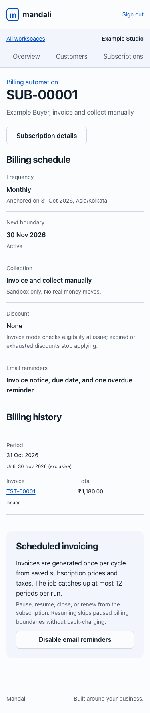

# Part 5: Recurring invoices, reminders, renewals, and authorized collection

Open an **active subscription → Set up recurring billing** as a workspace administrator. Review its existing snapshot prices, taxes, customer, and start date. Existing manually created invoices are not imported as historical billing cycles: explicitly choose the first date that has not already been billed. Existing subscriptions remain manual until a schedule is saved.

## Two scheduling authorities

**Invoice and collect manually:** Mandali generates and issues each due invoice. Daily, weekly, monthly, and yearly periods are supported. Choose real or sandbox invoices, optional email reminders, and an optional recurring discount. Collect the payment outside Mandali and record it against the invoice; sandbox invoices can also use the existing Test checkout. This mode never submits an automatic debit.

**Authorized Razorpay Test collection:** Razorpay owns the finite charging schedule; Mandali mirrors verified provider-cycle invoices and captures. Only the customer can authorize the mandate on Razorpay's hosted page. Saving a schedule, creating its link, or a merchant changing a local status cannot grant authorization. No card or bank details are stored by Mandali. Live keys remain rejected.

Automatic mode supports weekly, monthly, or yearly snapshot pricing with a positive fixed INR amount and 1–120 requested cycles, subject to provider limits. The first billing date must be tomorrow or later in Asia/Kolkata. Daily collection is unavailable because the provider's daily plan interval has a seven-day minimum. Automatic schedules cannot have a separate local expiry date or a changing discount; use invoice mode for those cases. The plan, quantity, amount, start timestamp, finite count, and mandate reference are checked against provider evidence. Account eligibility, payment methods, mandates, and permitted durations must be tested with the actual merchant account.

## Invoice timing and lifecycle

- Each schedule and period has one database-constrained billing cycle. Repeated jobs or callbacks cannot create another invoice for that cycle. Cancelled or paid historical cycles are preserved.
- Subscription lines, descriptions, prices, and taxes remain snapshots. Editing the product catalog does not rewrite recurring invoices. There is no proration or subscription-price amendment flow in this part.
- Monthly dates retain their original day: January 31 → February 28/29 → March 31. Yearly February 29 anchors recover the leap day in leap years. All boundaries use Asia/Kolkata; stored cycle ends are exclusive.
- A subscription expiry date is inclusive. A final partial period ends the next day but uses the full period price; there is no automatic proration. The original calendar boundary remains the cursor for any later renewal. When auto-close is enabled, the worker closes an expired term after its last due boundary has been handled. Without auto-close, it stops issuing after expiry and awaits a deliberate renewal/closure.
- Pausing prevents future invoices. Resume skips elapsed paused boundaries and never back-charges the pause. Renewing a paused term preserves its pause until explicitly resumed. Closing stops future billing without erasing existing debts.
- Renew extends an invoice-mode subscription's term when the plan allows it. Renewing a closed term resumes at the next calendar boundary without billing the closed gap. Already issued partial-period invoices are preserved. A completed automatic term needs a new subscription and fresh customer authorization; it is never silently extended.
- The worker catches up at most 12 invoice periods per schedule per execution and rotates through schedules fairly. A later execution continues from the stored cursor. Missed-run invoices are issued on the actual processing date, with payment terms measured from issue. Discount eligibility is checked on that same issue date; expired, disabled, exhausted, or ineligible discounts stop applying.

## Test authorization and payment recovery

1. Configure the existing workspace Razorpay Test gateway and `PAYMENT_ENCRYPTION_KEYS` as described in [checkout setup](CHECKOUT.md).
2. Save an automatic schedule, then click **Prepare authorization link**. This creates a dedicated provider plan and subscription. Share the provider URL with the intended customer, who reviews and authorizes it in Razorpay Test. An authorization-only payment has no billing period and never settles a recurring invoice.
3. Enable subscription webhooks on the existing versioned gateway URL: `subscription.authenticated`, `subscription.activated`, `subscription.charged`, `subscription.pending`, `subscription.halted`, `subscription.paused`, `subscription.resumed`, `subscription.cancelled`, and `subscription.completed` (and expiration events if available). Retain Part 3's payment events. Raw-body signatures are verified before network access; event IDs and body digests are deduplicated.
4. Use **Check provider status** or the scheduled worker to reconcile. Pending provider invoices remain visible and unpaid. Only a captured payment fetched from the provider, matching the subscription's invoice, order, fixed amount, currency, and period, records a ledger payment. Repeated capture evidence settles the same invoice once. Sandbox invoices remain excluded from real financial totals and website fulfillment webhooks.
5. Pause, resume, or cancel automatic collection under **Automation**. The provider must confirm the state. An uncertain action remains pending; local status changes cannot stop provider charges. A definitive rejection clears the pending action so recovery remains possible. Terminal provider states cannot be reopened by stale responses.

Creation timeouts never trigger an automatic second provider subscription. Locate the existing provider objects using the displayed mandate UUID in their `mandali_mandate` notes; enter the existing plan and/or subscription ID to recover. A recovered plan can continue preparation if no subscription was submitted. If an action remains uncertain, check/resolve it in Razorpay Test and reconcile; do not create another mandate as a fallback.

Conflicting references, overlapping periods, extra cycles, or mismatched/refunded payment evidence remain **review** records without an additional ledger payment. An unpaid review record can be rechecked after a reversible conflict is corrected. Recorded captures stay immutable; refund accounting is deferred to Part 7. Automatic cycle invoices cannot start a separate payment link, offline collection, or local cancellation while the provider owns collection. Cancelling the mandate does not automatically cancel unpaid invoices or refund prior captures.

Provider references: [plan API](https://razorpay.com/docs/api/payments/subscriptions/create-plan), [subscription invoices](https://razorpay.com/docs/api/payments/subscriptions/fetch-invoices), and [subscription notifications](https://razorpay.com/docs/payments/subscriptions/notifications/).

## Email notices and delivery uncertainty

Invoice mode can queue an issued notice, one due-date reminder, and one overdue reminder after three days. A due notice is not duplicated on the issue date; obsolete queued notices are skipped. Settled/cancelled invoices, disabled reminders, and missing recipients are skipped at delivery. Emails contain the invoice number, outstanding amount, due date, and business contact; they do not grant access to merchant pages or authorize payment. Sandbox notices explicitly say not to send real money. Automatic mode delegates mandate/collection notifications to the provider.

Use real SMTP configuration for deployment; local development uses the console backend. Sent means SMTP accepted the message, not guaranteed inbox delivery. SMTP errors or interrupted delivery remain **unknown** and are not automatically retried. Administrators can explicitly retry after checking their mail provider; that retry may duplicate a message if delivery had succeeded. Database claims prevent simultaneous workers from automatically sending the same notice. Review delivery history in Automation. Reminder preferences can be changed on invoice schedules.

## Run locally

```bash
export DJANGO_DEBUG=1
python manage.py migrate
python manage.py run_recurring --limit 100
```

This command performs configured billing and email work; run it only against the intended database. It never creates an authorization automatically. A database lease prevents overlapping worker runs and expires after 15 minutes if a worker crashes. The worker bounds catch-up and provider processing, preserves progress, and stops email claims before its time budget expires. Expired email leases become unknown. Check Automation and command output for schedule failures and uncertain deliveries.

## Google Cloud Run job and Cloud Scheduler

Deploy/migrate the web release first. Set `base_url` in your local deployment config to the deployed canonical HTTPS origin, then deploy the worker from the same image digest:

```bash
python scripts/deploy_recurring_job.py deploy/google-cloud/config.local.json
```

The helper creates/updates a private, single-task `mandali-billing` Cloud Run job using the runtime identity and pinned database, SMTP, and encryption secret references. It does not execute the job, deploy schema changes, or create a schedule. It sets zero task retries and a 600-second task timeout. Verify with dummy subscriptions before enabling scheduled billing.

After verification, create a separate scheduler identity and grant `roles/run.invoker` on **this job only**. Enable the Cloud Scheduler API and create an authenticated trigger; replace every uppercase placeholder:

```bash
gcloud run jobs add-iam-policy-binding mandali-billing \
  --project PROJECT_ID --region asia-south1 \
  --member serviceAccount:mandali-scheduler@PROJECT_ID.iam.gserviceaccount.com \
  --role roles/run.invoker

gcloud scheduler jobs create http mandali-billing-hourly \
  --project PROJECT_ID --location asia-south1 \
  --schedule '5 * * * *' --time-zone Asia/Kolkata \
  --uri 'https://run.googleapis.com/v2/projects/PROJECT_ID/locations/asia-south1/jobs/mandali-billing:run' \
  --http-method POST --headers 'Content-Type=application/json' --message-body '{}' \
  --oauth-service-account-email mandali-scheduler@PROJECT_ID.iam.gserviceaccount.com \
  --oauth-token-scope https://www.googleapis.com/auth/cloud-platform
```

The caller configuring the trigger needs permission to act as that scheduler identity. Retain Google's managed Cloud Scheduler service-agent permissions. Do not grant public invocation or give the scheduler database/Secret Manager permissions. Use OAuth for the Google API endpoint. See Google's [Cloud Scheduler job guide](https://cloud.google.com/run/docs/execute/jobs-on-schedule) and [job invocation permissions](https://cloud.google.com/run/docs/execute/jobs).

Job execution is asynchronous; monitor the Cloud Run execution result and logs, not just the Scheduler HTTP response. Start with a disabled/paused trigger if reviewing billing data, and pause the trigger before a restore or rollback that could replay old cursors. Stage/update the worker's image deliberately after promoting the matching web release; rolling back code does not undo invoices or provider mandates. Google Cloud and SMTP/provider services may incur charges; no cloud resources were created for this implementation.

## Verification limits

The suite covers calendar anchors, duplicate generation, paused renewals, discounts, uncertain creation/actions, unpaid/captured provider invoices, replay, tenant/admin access, SMTP claims, and PostgreSQL concurrency. Browser QA uses dummy business data and an isolated local provider fixture. No real merchant credentials were supplied: a genuine Razorpay Test authorization, subsequent recurring cycle, webhook delivery, SMTP inbox delivery, and scheduled Cloud Run execution still require deployment smoke testing. Live recurring payments, proration, mandate migration, customer self-service, and refund accounting are not enabled by this part. A full release/security audit remains Part 8.

## Screenshots

Dummy business data and local provider fixtures only.



[Authorized test collection on desktop](screenshots/recurring-authorization-desktop.png).
